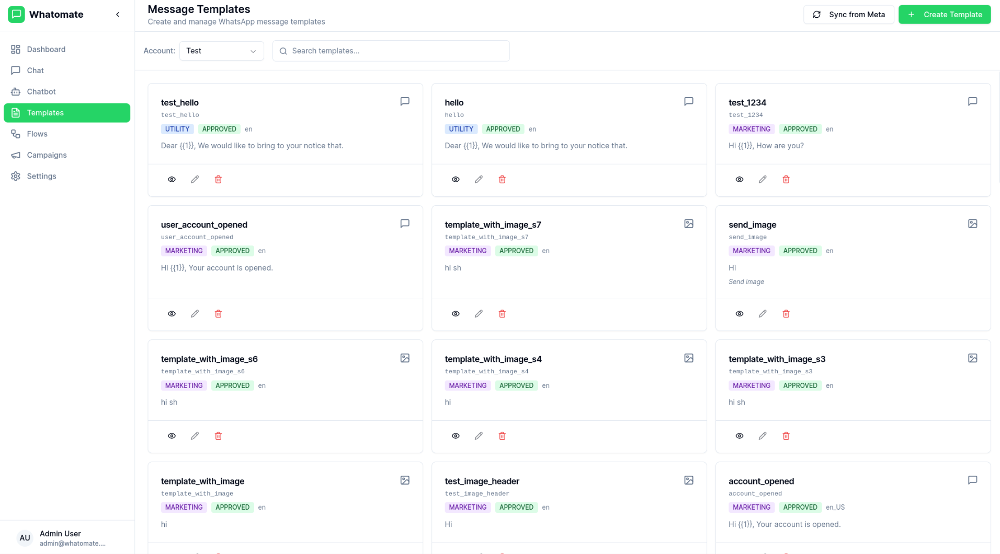
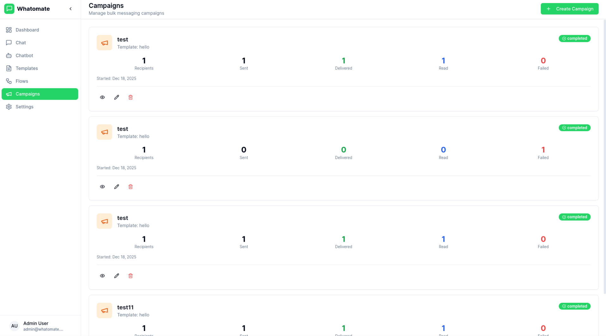

# WAPcrm

WhatsApp-first sales CRM, a product by LGS. Pipeline, follow-ups, lead capture and automation on top of a full WhatsApp Business inbox. Self-hosted, single binary.


## Features

- **Multi-tenant Architecture**
  Support multiple organizations with isolated data and configurations.

- **Granular Roles & Permissions**
  Customizable roles with fine-grained permissions. Create custom roles, assign specific permissions per resource (users, contacts, templates, etc.), and control access at the action level (read, create, update, delete). Super admins can manage multiple organizations.

- **WhatsApp Cloud API Integration**
  Connect with Meta's WhatsApp Business API for messaging.

- **Real-time Chat**
  Live messaging with WebSocket support for instant communication.

- **Template Management**
  Create and manage message templates approved by Meta.

- **Bulk Campaigns**
  Send campaigns to multiple contacts with retry support for failed messages.

- **Chatbot Automation**
  Keyword-based auto-replies, conversation flows with branching logic, and AI-powered responses (OpenAI, Anthropic, Google).

- **Canned Responses**
  Pre-defined quick replies with slash commands (`/shortcut`) and dynamic placeholders.

- **Voice Calling & IVR**
  Incoming and outgoing WhatsApp calls with IVR menus, DTMF routing, call transfers to agent teams, hold music, and call recording. See [calling docs](https://limegreen-studio.github.io/wapcrm/features/calling/).

- **Analytics Dashboard**
  Track messages, engagement, and campaign performance.

<details>
<summary>View more screenshots</summary>





</details>

## Installation

### Docker

Images are published to `ghcr.io/limegreen-studio/wapcrm` by the release workflow.

```bash
# Download compose file, sample config, and env file
curl -LO https://raw.githubusercontent.com/limegreen-studio/wapcrm/main/docker/docker-compose.yml
curl -LO https://raw.githubusercontent.com/limegreen-studio/wapcrm/main/config.example.toml
curl -L https://raw.githubusercontent.com/limegreen-studio/wapcrm/main/docker/.env.example -o .env

# Copy and edit config
cp config.example.toml config.toml
# Edit .env to set PostgreSQL credentials and timezone

# Run services
docker compose up -d
```

Go to `http://localhost:8080` and login with `admin@admin.com` / `admin`

__________________

### Binary

Download the [latest release](https://github.com/limegreen-studio/wapcrm/releases) and extract the binary.

```bash
# Copy and edit config
cp config.example.toml config.toml

# Run with migrations
./wapcrm server -migrate
```

Go to `http://localhost:8080` and login with `admin@admin.com` / `admin`

__________________

### Build from Source

```bash
git clone https://github.com/limegreen-studio/wapcrm.git
cd wapcrm

# Production build (single binary with embedded frontend)
make build-prod
./wapcrm server -migrate
```

See [configuration docs](https://limegreen-studio.github.io/wapcrm/getting-started/configuration/) for detailed setup options.

## CLI Usage

```bash
./wapcrm server              # API + 1 worker (default)
./wapcrm server -workers=0   # API only
./wapcrm worker -workers=4   # Workers only (for scaling)
./wapcrm version             # Show version
```

## Developers

The backend is written in Go ([Fastglue](https://github.com/zerodha/fastglue)) and the frontend is Vue.js 3 with shadcn-vue.
- If you are interested in contributing, please read [CONTRIBUTING.md](./CONTRIBUTING.md) first.

```bash
# Development setup
make run-migrate    # Backend (port 8080)
cd frontend && npm run dev   # Frontend (port 3000)
```

## License

AGPL-3.0. See [LICENSE](LICENSE) for details. WAPcrm is based on [Whatomate](https://github.com/shridarpatil/whatomate); see [NOTICE.md](NOTICE.md).
